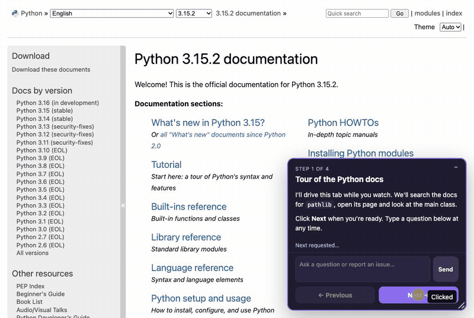
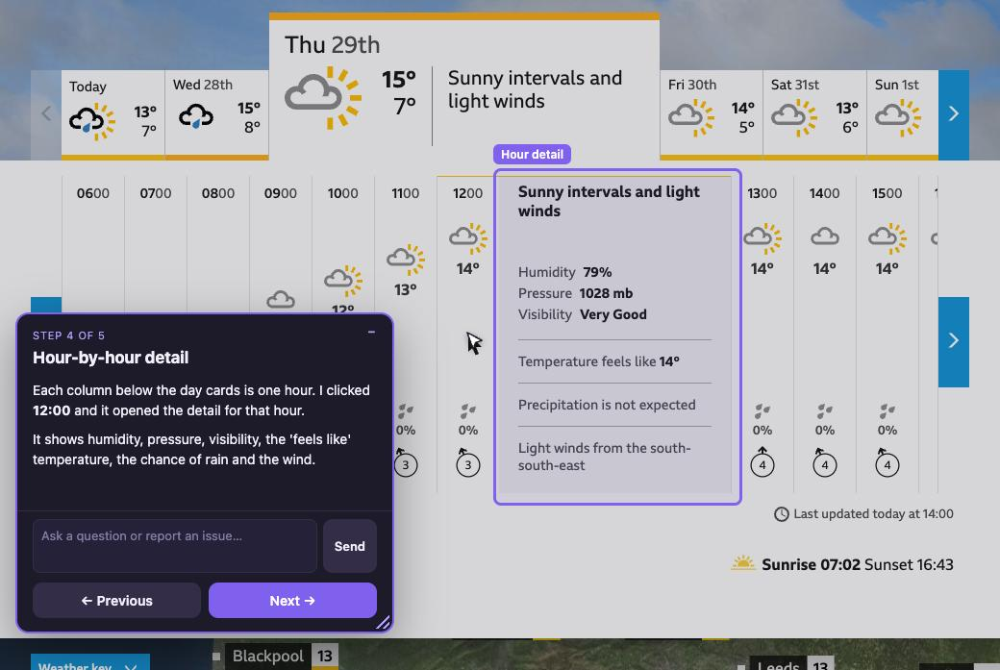

# Guided web walkthrough

A Claude Code skill that walks you through a website in your own Chrome. Claude drives the site (real clicks and typing) and explains each step in a small panel on the page. You set the pace with **Next** / **Previous**, and you can type questions into the panel at any time.



## What it is for

- Demo a code change or a new feature on a local or staging app.
- Tour a site, or one area of it, step by step.
- Review a change with Claude: issues you raise in the panel are collected as notes.

## How it works



1. Claude plans the story: one step per point, starting with an overview and ending with "Any other questions?".
2. Claude starts `guide-relay.py`, a small local server on `127.0.0.1:47610`, and injects `guide-panel.js` into the page with the Claude in Chrome extension.
3. On each **Next**, Claude moves a visible pointer to the target, clicks or types, highlights the elements it talks about, and shows the explanation in the panel.
4. A message typed into the panel goes to Claude, and the answer appears under the step.
5. On the last step, **Next** becomes **Close**. Claude stops the relay and lists the notes you raised.

The panel sends each click and message to the relay, and the relay prints it as one line on stdout. Claude watches that output with the Monitor tool, so it reacts as soon as you click. Some public sites block calls to `127.0.0.1` with a Content Security Policy. On those sites Claude waits for events inside the page instead (`__guide.waitForEvent`).

## Files

- `SKILL.md`: the instructions Claude follows.
- `guide-panel.js`: the panel. It works on any site; Claude passes in each step's content. The API is at the top of the file.
- `guide-relay.py`: the event relay (Python standard library only).
- `tests/panel-overlap.html`: browser test that the panel never covers a highlighted element.

## Use it

Ask Claude something like:

- "Walk me through the changes on this branch in the app."
- "Explain how to use bbc.co.uk/weather."

Requires the Claude in Chrome extension. On sites you don't own, Claude asks before it creates, changes, sends, buys or deletes anything. You type credentials and payment details yourself.

## Test

The test needs a real browser, because it relies on smooth scrolling:

```sh
python3 -m http.server -d ~/.claude/skills/guided-web-walkthrough 8000
open http://127.0.0.1:8000/tests/panel-overlap.html
```

The page shows `RESULT: PASS` or `RESULT: FAIL`, with one line per case.
